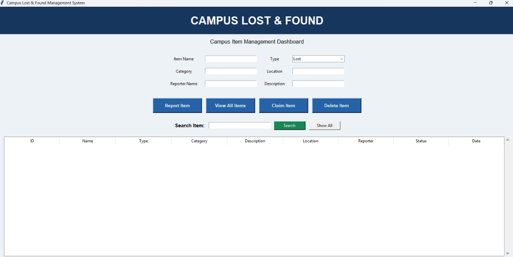

🎓 Campus Lost & Found Management System

A Smart Campus Solution for Reporting and Recovering Lost Items

📌 About the Project

The Campus Lost & Found Management System is a desktop-based application developed using Python Tkinter and MySQL. It helps students and staff report lost or found items within the college campus.

The system provides a simple graphical interface to manage item records, search for belongings, and update their claim status.

🎯 Objectives

- To provide a centralized platform for lost and found items.
- To make reporting lost and found belongings easier.
- To help users search for missing items.
- To maintain item details securely in a database.
- To reduce the time required to recover lost belongings.

✨ Features

- Report Item: Add details of lost or found items.
- View All Items: Display all reported items.
- Search Items: Find items using their names.
- Claim Item: Update the status of an item.
- Delete Item: Remove unwanted records.
- Database Management: Store item information using MySQL.

🛠️ Technologies Used

Technology| Purpose
Python| Application programming
Tkinter| Graphical User Interface
MySQL| Database management
MySQL Connector| Python–MySQL connection
Notepad++| Code editor

🗄️ Database Details

Database Name: "campus_lost_found"

Table Name: "items"

The database stores:

- Item ID
- Item Name
- Item Type (Lost / Found)
- Category
- Description
- Location
- Reporter Name
- Status
- Reported Date

⚙️ Installation and Execution

1. Install Python on your computer.

2. Install MySQL Server and MySQL Workbench.

3. Install the MySQL connector:
   
   pip install mysql-connector-python

4. Create the "campus_lost_found" database and "items" table in MySQL.

5. Update the MySQL username and password in the Python program.

6. Run the application:
   
   python campus_lost_found.py

👨‍💻 Project Team

1. K. Veera Venkata Ganesh
   Registration No: RA2511026010870

2. B. Manjunath Reddy
   Registration No: RA2511026010882

3. Venkata Sai Tejeesh Ch
   Registration No: RA2511026010887

🚀 Future Enhancements

- User login and registration.
- Image upload for lost and found items.
- Email notifications when a matching item is found.
- Advanced search and filtering options.

📌 Conclusion

The Campus Lost & Found Management System provides an easy and organized way to manage lost and found belongings in a college environment. It combines Python GUI development with MySQL database management to offer a practical campus solution.

---

Developed with Python | Tkinter | MySQL
---

## 🖥️ Application Preview

## 👨‍💻 Team Members

1. K. Veera Venkata Ganesh — RA2511026010870
2. B. Manjunath Reddy — RA2511026010882
3. Venkata Sai Tejeesh Ch — RA2511026010887

## 🔧 Technologies Used

- Python
- Tkinter (GUI)
- MySQL Database
- mysql-connector-python

## ✨ Future Enhancements

- User login and registration
- Email notifications
- Image upload for lost items
- Advanced search and filtering

## 📌 Conclusion

The Campus Lost & Found Management System provides an easy way for students and staff to report and recover lost belongings.

---
⭐ Developed as a College Project
